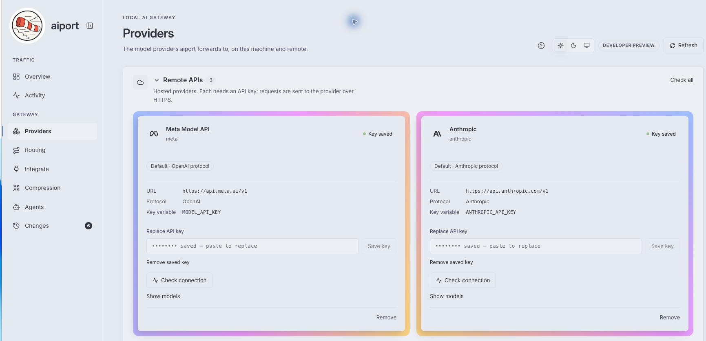

<p align="center">
  
</p>

# aiport

A local AI gateway for the applications and coding agents on your machine: one
place for provider keys, routing and request history, that notices when an
application keeps failing and offers to fix it.

<p align="center">
  
</p>

## Quickstart

You need Go 1.27+ (`brew install go`, or https://go.dev/dl). Nothing else:
dependencies are vendored and the dashboard is committed pre-built.

```sh
git clone https://github.com/harelix/aiport && cd aiport
make build                 # -> bin/aiport, dashboard embedded
./bin/aiport init          # choose providers and coding agents; writes aiport.yaml
./bin/aiport serve         # prints the dashboard URL and management token
```

Open http://127.0.0.1:8787/, paste the management token, and set a password.
Add your provider keys on **Settings**, then **Check connection** on each card
(one free `GET /models`, nothing generated). Start any local provider (Ollama,
llama.cpp) yourself.

## Why aiport

- **Applications never hold provider keys.** Each one pairs for its own local
  token, approved by you; aiport adds the real key on the way out.
- **Native forwarding.** Chat Completions, Responses and Messages are passed
  through byte for byte in the provider's own format; aiport does no
  translation, so nothing is lost between SDK and provider.
- **It adapts to its Applications, with your approval.** aiport watches its
  request history. When an error keeps happening for one Application it opens
  an **Issue** with the evidence and a fix on each side: a Change in aiport
  you approve with one click, and an instruction for the Application's coding
  agent. It can also ask your installed coding agent to **Explain** the root
  cause or **Fix it** in a separate worktree, ending in a diff you keep or
  discard.
- **Local and private.** It listens on loopback only, refuses cross-site
  requests, and records request metadata, never prompts or responses.

## Usage

The [user manual](docs/manual.md) walks through every page of the dashboard. It
is also built into the dashboard (the help button in the header). The main
tasks:

**Connect an application.** Open **Integrate** and copy the instruction at the
top to the coding agent working on that application. The agent switches the
application's SDK to aiport and pairs it; you approve the short code it shows.
Any running gateway also describes itself without a token:

```sh
curl 'http://127.0.0.1:8787/_connect?format=markdown'   # guide for people and agents
curl http://127.0.0.1:8787/_connect                     # JSON for programs
```

See [Connect](docs/connect.md) and the manual's
[Integrate page](docs/manual.md#the-integrate-page-and-the-two-briefs) section.

**Launch a coding agent through aiport.**

```sh
./bin/aiport agent claude --model YOUR_ANTHROPIC_MODEL
./bin/aiport agent codex --model YOUR_OPENAI_MODEL      # add --dry-run to inspect
```

The agent gets its own local token, never your provider keys, and its global
settings are not edited. The Connection it uses must speak the agent's
protocol.

**Decide on Changes.** **Changes** shows Issues, Suggestions and Change
requests, with a badge only when one needs you. Every Change can be reverted.
See [Changes](docs/manual.md#changes).

## Configuration

`init` writes `aiport.yaml` and a private `aiport.yaml.env` (mode 0600) holding
local tokens and the keys you paste in the dashboard. It never overwrites
existing files. Provider keys never go into YAML.

```sh
./bin/aiport init --provider openai,anthropic --agent codex,claude   # no prompts
./bin/aiport check                                                    # validate
./bin/aiport auth token                                               # print the management token again
```

Preset providers: `openai`, `anthropic`, `bedrock`, `meta`, `ollama`,
`llamacpp`. `--base-url` overrides one provider's address, and `--region` sets
the Bedrock region (default `us-east-1`). Request history is kept in SQLite
next to the config (`telemetry.enabled`, `retention_days`, default 7). See the
[configuration reference](docs/configuration.md), and
[`aiport.example.yaml`](aiport.example.yaml).

## What runs and what leaves the machine

- aiport sends calls only to the Connections you configured, with the key for
  that Connection. It stores request metadata (time, Application, model,
  status, latency), never prompts or responses.
- **Agent runs** start a coding agent you installed (Claude Code, Codex or
  Gemini CLI, through the Agent Client Protocol) in a git worktree of the
  Application's repository, only when you click. Commands ask you first;
  aiport never commits to your branch, merges or pushes. aiport only sees the
  permission requests an agent sends, so an agent's own settings can allow
  more. Read [What aiport cannot see](docs/manual.md#explain-by-a-coding-agent) before using them.
- [Extensions](docs/extensions.md) you add are programs started by aiport to
  take part in decisions about Change requests.

## Limitations

- Experimental. No provider and coding-agent combination has passed the live
  [compatibility](docs/compatibility.md) gate yet.
- Token counts and cost are not measured.
- No translation between protocols: a Connection must speak the protocol of
  the client calling it. Ollama or llama.cpp Chat compatibility does not make
  them work with Codex.
- Gemini runs' model calls do not go through aiport, and Codex runs use
  Codex's own login.
- No release archives yet; build from source (`make release` produces them).

## Contributing

See [CONTRIBUTING.md](CONTRIBUTING.md): `make test`, `make check`,
`make check-offline`, and a DCO sign-off on every commit. Larger changes start
from [the design](aiport_DESIGN.md); the vocabulary is in the
[glossary](GLOSSARY.md). Dependency licenses are in
[THIRD_PARTY.md](THIRD_PARTY.md).

## License

[Apache-2.0](LICENSE). The aiport name and logo are covered by
[TRADEMARKS.md](TRADEMARKS.md).
