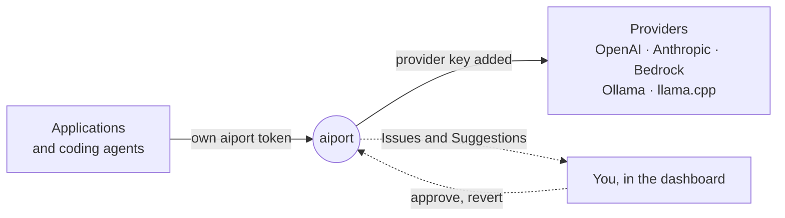

<div align="center">


<h1>aiport</h1>

<p><strong>A local AI gateway for the applications and coding agents on your machine.</strong><br>
One place for provider keys, routing and request history, that notices when an application keeps failing and offers to fix it.</p>

<p>
  <a href="LICENSE"></a>
  
  
</p>

<p>
  <a href="#quickstart">Quickstart</a> ·
  <a href="docs/manual.md">Manual</a> ·
  <a href="docs/connect.md">Connect an application</a> ·
  <a href="docs/configuration.md">Configuration</a> ·
  <a href="CONTRIBUTING.md">Contributing</a>
</p>


</div>

## Why aiport

| | |
|---|---|
| **Keys stay in aiport** | Each application pairs for its own local token, approved by you. aiport adds the real provider key on the way out. |
| **Native forwarding** | Chat Completions, Responses and Messages pass through byte for byte, in the provider's own format. Nothing is translated, so nothing is lost. |
| **Adapts, with your approval** | When an application keeps failing, aiport opens an Issue with the evidence and a fix on each side: a Change you approve in one click, and instructions for the application's coding agent. |
| **Applications know what they can use** | `GET /v1/models` lists each application's Levels, task names and models (its Catalog), and an `X-Aiport-Catalog` header tells it when you change them. Remove any Connection: aiport re-points what used it as one revertable Change and tells every application it affects. |
| **Name the need, not the provider** | Applications send a Level (`fast`, `balanced`, `best`) or a task name, and say how hard a call is with `X-Aiport-Effort`; you map each to a Connection and model in the dashboard, and the Routing map shows where every name goes. |
| **Local and private** | Loopback only, cross-site requests refused, and only request metadata is kept: never prompts or responses. |

## How it works



Applications call aiport with their own token. aiport routes each call to the provider you chose, keeps the metadata, and turns repeated failures into Issues you can fix from the dashboard, or hand to the application's coding agent.

## Quickstart

You need **Go 1.27+** (`brew install go`, or [go.dev/dl](https://go.dev/dl)). Dependencies are vendored and the dashboard is pre-built, so nothing else is downloaded.

```sh
git clone https://github.com/harelix/aiport && cd aiport
make build              # bin/aiport, dashboard included
./bin/aiport init       # choose providers and coding agents; writes aiport.yaml
./bin/aiport serve      # prints the dashboard address and management token
```

Open the dashboard address `serve` prints (**http://127.0.0.1:8787/** by default; `init --listen` picks another, and you can [use `aiport.localhost` instead](docs/manual.md#use-a-name-instead-of-127001)), paste the management token and set a password. Paste your provider keys on **Providers**, then **Check connection** on each card: it makes one free `GET /models` call and generates nothing. Start any local provider (Ollama, llama.cpp) yourself.

## Using it

- **Connect an application.** On **Integrate**, copy the instruction at the top to the coding agent working on the application. It switches the application's SDK to aiport and pairs it; you approve the short code it shows. See [Connect](docs/connect.md).
- **Launch a coding agent through aiport.** `./bin/aiport agent claude --model MODEL` or `./bin/aiport agent codex --model MODEL` (add `--dry-run` to inspect). The agent gets its own token, never your provider keys.
- **Decide on Changes.** Issues, Suggestions and Change requests wait on **Changes**, with a badge only when one needs you. Every Change can be reverted.

The [manual](docs/manual.md) covers every page. It is also built into the dashboard: press the help button, or the ⓘ next to any section.

## Configuration

`init` writes `aiport.yaml` and a private `aiport.yaml.env` (mode 0600) for local tokens and the keys you paste in the dashboard. It never overwrites a file, and provider keys never go into YAML.

```sh
./bin/aiport init --provider openai,anthropic --agent codex,claude   # without prompts
./bin/aiport check                                                    # validate the configuration
./bin/aiport auth token                                               # print the management token again
```

Provider presets: `openai`, `anthropic`, `bedrock`, `meta`, `ollama`, `llamacpp`. See the [configuration reference](docs/configuration.md) and [`aiport.example.yaml`](aiport.example.yaml).

## Security and data

- Calls go only to the providers you configured, with that provider's key. aiport stores request metadata (time, application, model, status, latency), never prompts or responses.
- **Agent runs** start a coding agent you installed (Claude Code, Codex or Gemini CLI) in a separate git worktree, only when you click. Commands ask you first, and aiport never commits to your branch, merges or pushes. An agent's own settings can allow more than aiport sees: read [what aiport cannot see](docs/manual.md#explain-by-a-coding-agent) first.
- [Extensions](docs/extensions.md) you add take part in decisions about Change requests.

## Limitations

aiport is experimental. No provider and coding-agent combination has passed the live [compatibility](docs/compatibility.md) gate yet. Token counts and cost are not measured. A provider must speak the protocol of the client calling it, since aiport does not translate. Gemini runs' model calls do not go through aiport, and Codex runs use Codex's own login. There are no release downloads yet; build from source.

## Contributing

See [CONTRIBUTING.md](CONTRIBUTING.md). Run `make test`, `make check` and `make check-offline`, and sign off every commit (DCO). Larger changes start from [the design](aiport_DESIGN.md); the vocabulary is in the [glossary](GLOSSARY.md), and dependency licenses are in [THIRD_PARTY.md](THIRD_PARTY.md).

## License

[Apache-2.0](LICENSE). The aiport name and logo are covered by [TRADEMARKS.md](TRADEMARKS.md).
